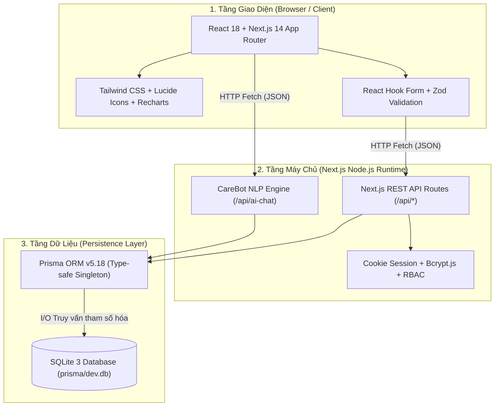
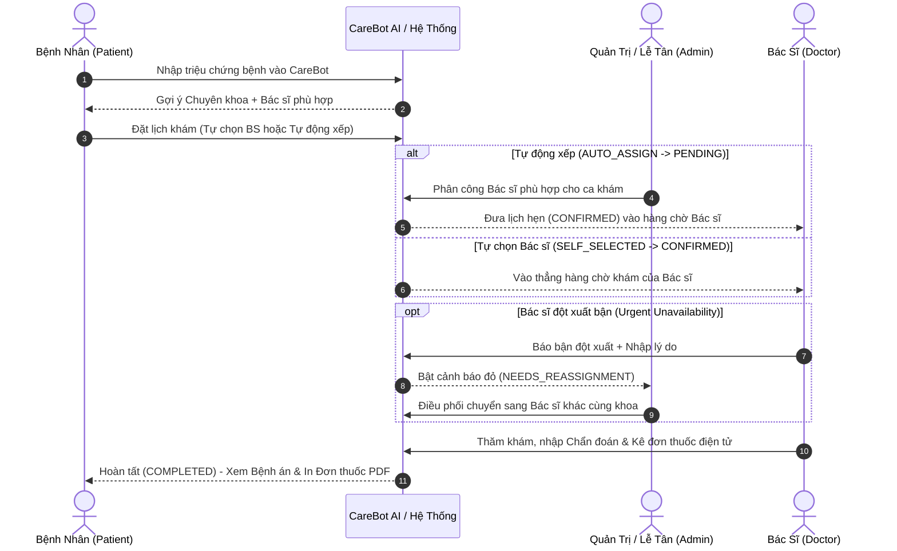

# 🏥 Phòng Khám 2026 (Clinic Management System)

Hệ thống quản lý phòng khám hiện đại, tối ưu cho việc đặt lịch khám, quản lý hồ sơ bệnh án, kê đơn thuốc và phân công bác sĩ tự động/thủ công. Dự án được xây dựng theo kiến trúc Full-stack với **Next.js 14 (App Router)**, **TypeScript**, **Prisma ORM** và **Tailwind CSS**.

---

## 🚀 Các Công Nghệ Được Áp Dụng (Chi Tiết & Đầy Đủ)

### 1. Nền Tảng Cốt Lõi & Ngôn Ngữ Lập Trình (Core Framework & Language)

| Công nghệ | Phiên bản | Vai trò & Ứng dụng thực tế trong dự án | File tiêu biểu |
| :--- | :--- | :--- | :--- |
| **[Next.js (App Router)](https://nextjs.org/)** | `14.2.5` | Framework Full-stack chủ đạo của dự án. Quản lý định tuyến theo thư mục (`src/app`), kết hợp **Server Components** và **Client Components** (`'use client'`), đồng thời tích hợp sẵn **Server API Routes** làm Backend mà không cần tách server Express riêng. | `next.config.mjs`, `src/app/layout.tsx` |
| **[React](https://react.dev/) & React DOM** | `18.3.1` | Thư viện cốt lõi xây dựng giao diện hướng thành phần (Component-based UI). Sử dụng các React Hooks (`useState`, `useEffect`, `useMemo`, `useRef`) để quản lý trạng thái đặt lịch, giỏ thuốc, bộ lọc tìm kiếm và chatbot. | `src/app/page.tsx` |
| **[TypeScript](https://www.typescriptlang.org/)** | `5.5.4` | Ngôn ngữ chính (`strict: true`). Đảm bảo **Type Safety** xuyên suốt từ giao diện, dữ liệu gửi qua API cho tới các bảng truy vấn trong CSDL, giúp phát hiện lỗi ngay lúc biên dịch (Compile-time). | `tsconfig.json`, `src/types/index.ts` |
| **Node.js Runtime** | `v20+` | Môi trường thực thi phía máy chủ (Server-side runtime) cho Next.js API Routes, Prisma ORM và các tác vụ đọc/ghi file CSDL. | `package.json` |

### 2. Giao Diện, Thiết Kế & Trực Quan Hóa Dữ Liệu (UI, Styling & Data Visualization)

| Công nghệ | Phiên bản | Vai trò & Ứng dụng thực tế trong dự án | File tiêu biểu |
| :--- | :--- | :--- | :--- |
| **[Tailwind CSS](https://tailwindcss.com/)** | `3.4.7` | Utility-first CSS Framework dùng để thiết kế toàn bộ giao diện theo tông màu y tế (`brand` / `clinic` xanh ngọc `#4fc3a1`, `#10b981`) và tối ưu hiển thị đa thiết bị (Responsive Mobile / Tablet / Desktop). | `tailwind.config.ts`, `src/app/globals.css` |
| **[PostCSS](https://postcss.org/) & Autoprefixer** | `8.4.40` / `10.4.20` | Công cụ biên dịch CSS và tự động thêm tiền tố (`-webkit-`, `-moz-`) đảm bảo tương thích trên mọi trình duyệt. | `postcss.config.mjs` |
| **[Lucide React](https://lucide.dev/)** | `0.427.0` | Bộ thư viện icon vector SVG y tế hiện đại (`HeartPulse`, `Stethoscope`, `Calendar`, `Baby`, `Shield`, `FileText`...) dùng trên toàn hệ thống. | `src/components/layout/Navbar.tsx` |
| **[Recharts](https://recharts.org/)** | `2.12.7` | Thư viện vẽ biểu đồ thống kê trực quan trong phân hệ **Admin** (biểu đồ doanh thu, số ca khám theo chuyên khoa, tỷ lệ trạng thái lịch hẹn). | `src/app/admin/page.tsx` |
| **[Sonner](https://sonner.emilkowal.ski/)** | `1.5.0` | Thư viện hiển thị thông báo nổi (**Toast Notifications**) mượt mà khi người dùng đặt lịch thành công, bác sĩ lưu bệnh án hoặc báo lỗi đăng nhập. | `src/app/layout.tsx` |
| **clsx & tailwind-merge** | `2.1.1` / `2.4.0` | Tiện ích gộp class CSS động thông minh (hàm `cn()`), giúp tránh xung đột class Tailwind khi xây dựng hệ thống Design System (`Button`, `Card`, `Badge`, `Modal`, `Input`). | `src/lib/utils.ts` |

### 3. Quản Lý Biểu Mẫu & Kiểm Định Dữ Liệu (Form Handling & Schema Validation)

| Công nghệ | Phiên bản | Vai trò & Ứng dụng thực tế trong dự án | File tiêu biểu |
| :--- | :--- | :--- | :--- |
| **[React Hook Form](https://react-hook-form.com/)** | `7.52.2` | Quản lý trạng thái các biểu mẫu phức tạp (Form Đặt lịch 3 bước, Form Khám bệnh & Kê đơn nhiều dòng thuốc, Form Đăng ký/Đăng nhập) với hiệu năng cao, hạn chế re-render. | `src/app/book/page.tsx`, `src/app/doctor/page.tsx` |
| **[Zod](https://zod.dev/)** | `3.23.8` | Khai báo Schema kiểm định dữ liệu chặt chẽ (ràng buộc định dạng số điện thoại Việt Nam 10 số, ngày khám không ở quá khứ, mật khẩu tối thiểu 6 ký tự, thông tin đơn thuốc...). | `src/lib/validations.ts` |
| **@hookform/resolvers** | `3.9.0` | Cầu nối tích hợp trực tiếp **Zod Schema** vào **React Hook Form** để tự động bắt lỗi và hiển thị thông báo tiếng Việt trên giao diện. | `src/app/register/page.tsx` |
| **[date-fns](https://date-fns.org/)** | `3.6.0` | Thư viện xử lý, so sánh và định dạng ngày giờ khám bệnh, tính toán lịch trực theo thứ trong tuần của bác sĩ. | `src/lib/utils.ts` |

### 4. Kiến Trúc Backend, API & Xử Lý Nghiệp Vụ (Backend & Business Logic)

| Công nghệ / Kỹ thuật | Chi tiết triển khai trong dự án | File tiêu biểu |
| :--- | :--- | :--- |
| **Next.js RESTful API Routes** | Xây dựng hệ thống các endpoints chuẩn REST (`GET`, `POST`, `PUT`, `DELETE`) trả về dữ liệu `JSON` qua `NextResponse`. Bao gồm: `/api/auth/*`, `/api/appointments`, `/api/consultations`, `/api/doctors`, `/api/specialties`, `/api/notifications`, `/api/stats`, `/api/ai-chat`. | `src/app/api/appointments/route.ts`, `src/app/api/consultations/route.ts` |
| **Native Fetch API** | Giao tiếp bất đồng bộ (`async/await`) giữa Client và Server mà không cần cài thêm thư viện ngoài như Axios, tối ưu dung lượng bundle. | `src/app/dashboard/page.tsx` |
| **CareBot — Trợ lý AI Phân luồng Y tế** | Hệ thống Chatbot thông minh xử lý ngôn ngữ tự nhiên tiếng Việt (khử dấu, so khớp từ khóa triệu chứng có trọng số - Weighted Rule-based NLP), phát hiện dấu hiệu cấp cứu khẩn cấp (Red Flags) và tự động truy vấn CSDL gợi ý đúng Chuyên khoa + Bác sĩ tiêu biểu. | `src/components/chat/AIChatBot.tsx`, `src/app/api/ai-chat/route.ts` |

### 5. Cơ Sở Dữ Liệu & Tầng ORM (Database & Persistence Layer)

| Công nghệ | Phiên bản | Vai trò & Ứng dụng thực tế trong dự án | File tiêu biểu |
| :--- | :--- | :--- | :--- |
| **[SQLite 3](https://www.sqlite.org/)** | Embedded DB | Hệ quản trị cơ sở dữ liệu quan hệ nhúng lưu trữ trực tiếp trong tệp nhị phân `prisma/dev.db`. Không cần cài đặt dịch vụ chạy nền, tốc độ đọc/ghi I/O cực nhanh và dễ dàng sao lưu/di chuyển toàn bộ dự án. Quản lý **8 bảng quan hệ**: `User`, `Specialty`, `DoctorInfo`, `DoctorSchedule`, `Appointment`, `MedicalRecord`, `Prescription`, `Notification`. | `prisma/schema.prisma` |
| **[Prisma ORM](https://www.prisma.io/) & Prisma Client** | `5.18.0` | Tầng ánh xạ đối tượng - quan hệ (Object-Relational Mapping). Tự động sinh bộ hàm truy vấn Type-safe, chống 100% lỗi bảo mật **SQL Injection** và áp dụng **Singleton Pattern** để tránh nghẽn kết nối khi Hot-Reload. | `src/database/prisma.ts`, `src/lib/prisma.ts` |
| **[tsx (TypeScript Execute)](https://github.com/privatenumber/tsx)** | `4.17.0` | Công cụ chạy trực tiếp script khởi tạo dữ liệu mẫu (`prisma/seed.ts`) bằng TypeScript để nạp sẵn 10 Chuyên khoa, 30 Bác sĩ, Lịch làm việc và Bệnh nhân mẫu. | `prisma/seed.ts` |
| **Prisma Studio & DB Browser for SQLite** | Công cụ GUI | Giao diện trực quan (Web GUI ở cổng `5555` với lệnh `npm run db:studio` và phần mềm Desktop) giúp xem, lọc, sửa dữ liệu và thực thi truy vấn SQL trực tiếp. | `KTHT.md` |

### 6. Xác Thực, Bảo Mật & Phân Quyền (Authentication, Security & RBAC)

| Công nghệ / Cơ chế | Phiên bản | Vai trò & Ứng dụng thực tế trong dự án | File tiêu biểu |
| :--- | :--- | :--- | :--- |
| **[Bcrypt.js (`bcryptjs`)](https://github.com/dcodeIO/bcrypt.js)** | `2.4.3` | Mã hóa mật khẩu người dùng một chiều kèm chuỗi ngẫu nhiên (**Salt hashing** với `saltRounds = 10`) trước khi lưu vào bảng `User` và đối chiếu khi đăng nhập. | `src/app/api/auth/login/route.ts`, `src/app/api/auth/register/route.ts` |
| **HTTP Cookie Session (`next/headers`)** | Native Next.js | Quản lý phiên đăng nhập qua Cookie định danh `phongkham_session_user`, đọc và xác thực phiên trực tiếp ở phía Server. | `src/backend/auth/session.ts` |
| **Phân quyền RBAC (Role-Based Access Control)** | 3 Vai trò | Kiểm soát quyền truy cập nghiêm ngặt theo 3 vai trò: **`PATIENT`** (Đặt lịch, xem hồ sơ & đơn thuốc), **`DOCTOR`** (Xem ca trực, khám bệnh, kê đơn, báo bận), **`ADMIN`** (Thống kê tổng quan, điều phối/xếp bác sĩ, quản lý danh mục khoa & bác sĩ). | `src/backend/auth/session.ts` |

### 7. Sơ Đồ Phối Hợp Công Nghệ (Tech Stack Flow)



---

## 🏗️ Kiến Trúc Hệ Thống & Phân Quyền (RBAC)

Hệ thống phân quyền 3 vai trò chính dựa trên `Role`:

```
+-------------------------------------------------------------------+
|                        Next.js App Router                         |
+-------------------------------------------------------------------+
       |                            |                           |
       v                            v                           v
[PATIENT - Bệnh nhân]      [DOCTOR - Bác sĩ]        [ADMIN - Quản trị]
- Tìm kiếm bác sĩ          - Xem ca khám            - Thống kê tổng quan
- Đặt lịch khám            - Nhập hồ sơ bệnh án     - Phân công bác sĩ
- Xem đơn thuốc / lịch sử  - Kê đơn thuốc           - Quản lý danh mục
       |                            |                           |
       +----------------------------+---------------------------+
                                    |
                                    v
                         [Server API / Prisma ORM]
                                    |
                                    v
                           [SQLite Database]
```

### Các Mô Hình Dữ Liệu Chính (Data Models)
* **User**: Người dùng hệ thống (`ADMIN`, `DOCTOR`, `PATIENT`).
* **DoctorInfo**: Thông tin bằng cấp, kinh nghiệm, chuyên khoa, giá khám của Bác sĩ.
* **DoctorSchedule**: Lịch làm việc theo thứ / giờ của từng Bác sĩ.
* **Specialty**: Danh mục Chuyên khoa (Nội khoa, Nhi khoa, Tim mạch, v.v.).
* **Appointment**: Lịch hẹn khám (Trạng thái: `PENDING`, `CONFIRMED`, `COMPLETED`, `CANCELLED`, `NEEDS_REASSIGNMENT`).
* **MedicalRecord**: Hồ sơ bệnh án chi tiết gắn liền với Lịch hẹn.
* **Prescription**: Đơn thuốc đi kèm Hồ sơ bệnh án.
* **Notification**: Hệ thống thông báo thời gian thực cho người dùng.

---

## 🩺 Các Chức Năng Cốt Lõi Theo Từng Phân Hệ (Core Features)

Hệ thống được thiết kế theo mô hình **RBAC (Role-Based Access Control)** với **3 phân hệ người dùng chính** liên kết chặt chẽ từ khâu tư vấn, đặt lịch, điều phối, khám bệnh cho tới phát hành đơn thuốc điện tử:

### 1. Phân Hệ Bệnh Nhân & Khách Truy Cập (`PATIENT` / `GUEST`)

#### 1.1. Trang Chủ & Khám Phá Dịch Vụ Y Tế (`src/app/page.tsx`)
* **Danh mục 10 Chuyên khoa nổi bật:** Hiển thị trực quan thông tin, biểu tượng và mô tả của 10 chuyên khoa (Tim Mạch, Nhi, Da Liễu, Nội Tổng Quát, Tai Mũi Họng, Mắt, Răng Hàm Mặt, Cơ Xương Khớp, Sản Phụ Khoa, Tiêu Hóa - Gan Mật), cho phép chọn đặt lịch trực tiếp theo từng khoa.
* **Đội ngũ Bác sĩ tiêu biểu:** Tự động lọc và giới thiệu các Bác sĩ đầu ngành có số năm kinh nghiệm cao nhất kèm học vị (ThS, BS CKI, BS CKII, TS), tiểu sử chuyên môn, chi phí khám và nút đặt khám đích danh với bác sĩ đó.

#### 1.2. Trợ Lý Bác Sĩ Ảo AI — CareBot 24/7 (`src/components/chat/AIChatBot.tsx`, `src/app/api/ai-chat/route.ts`)
* **Phân tích triệu chứng & Phân luồng chuyên khoa:** Bệnh nhân nhập triệu chứng bằng tiếng Việt (có dấu hoặc không dấu), CareBot tự động phân tích từ khóa triệu chứng để gợi ý chính xác **Chuyên khoa cần khám**, giải thích nguyên nhân sơ bộ và đưa ra lời khuyên chăm sóc tại nhà.
* **Gợi ý Bác sĩ & Đặt lịch 1 chạm:** Ngay trong khung chat, CareBot hiển thị thẻ Chuyên khoa và danh sách 3 Bác sĩ phụ trách kèm nút **"Đặt Lịch Khám Ngay"** chuyển thẳng đến bước đặt hẹn đã điền sẵn khoa/bác sĩ.
* **Cảnh báo Y tế Khẩn cấp (Red Flags Detection):** Tự động phát hiện các từ khóa nguy kịch (đột quỵ, khó thở dữ dội, hôn mê, co giật, nôn ra máu...) để bật hộp cảnh báo đỏ khẩn cấp kèm nút gọi nhanh cấp cứu `115` và Hotline phòng khám.

#### 1.3. Đặt Lịch Khám Trực Tuyến 3 Bước Thông Minh (`src/app/book/page.tsx`)
* **Bước 1 — Chọn Chuyên khoa & Hình thức xếp Bác sĩ:** Hỗ trợ **2 luồng đặt lịch linh hoạt**:
  1. **Tự chọn Bác sĩ (`SELF_SELECTED`):** Bệnh nhân chủ động chọn bác sĩ mong muốn; lịch hẹn sau khi đặt sẽ được chuyển ngay sang trạng thái **`CONFIRMED` (Đã xác nhận & Chờ khám)**.
  2. **Hệ thống tự động xếp (`AUTO_ASSIGN`):** Phù hợp khi bệnh nhân không biết chọn bác sĩ nào; lịch hẹn sẽ mang trạng thái **`PENDING` (Chờ sắp xếp bác sĩ)** để Quản trị viên/Lễ tân điều phối bác sĩ đang rảnh.
* **Bước 2 — Chọn Ngày & Khung giờ khám theo thời gian thực:** Tự động kiểm tra lịch trực của bác sĩ và loại trừ các khung giờ (slot 30 phút buổi Sáng / Chiều) đã có người đặt để chống trùng lịch.
* **Bước 3 — Xác nhận thông tin:** Tự động điền Họ tên, SĐT, Email nếu bệnh nhân đã đăng nhập, hoặc cho phép khách vãng lai đặt nhanh bằng Số điện thoại (tự động tạo/liên kết hồ sơ bệnh nhân).

#### 1.4. Cổng Hồ Sơ Y Tế, Bệnh Án & Đơn Thuốc Điện Tử (`src/app/dashboard/page.tsx`)
* **Tra cứu kép (Tài khoản hoặc Số điện thoại):** Bệnh nhân có thể đăng nhập hoặc chỉ cần nhập **Số điện thoại** đã đặt lịch để tra cứu toàn bộ lịch sử khám.
* **Quản lý Lịch hẹn sắp tới:** Xem trạng thái lịch hẹn theo thời gian thực (`Chờ sắp xếp bác sĩ`, `Đã xác nhận`, `Đang chờ đổi bác sĩ`, `Đã hoàn thành`), hỗ trợ **Hủy lịch hẹn** trực tuyến khi có việc bận.
* **Xem Lịch sử Khám & Chẩn đoán Lâm sàng:** Xem chi tiết hồ sơ bệnh án sau mỗi lần khám gồm: Bác sĩ điều trị, Triệu chứng lâm sàng, Kết luận chẩn đoán và Lời dặn dò của bác sĩ.
* **Đơn Thuốc Điện Tử & In PDF (`window.print`):** Xem danh mục thuốc được kê (Tên thuốc, Hàm lượng, Liều dùng, Thời gian uống) và mở **Modal Phiếu Đơn Thuốc Điện Tử chuẩn Y khoa** để in hoặc lưu thành file PDF.
* **Quản lý Hồ sơ cá nhân & Bảo mật:** Cập nhật Họ tên, SĐT, Email, đổi mật khẩu bảo mật và thay đổi **Ảnh đại diện (Avatar)** (tải ảnh trực tiếp từ máy tính, chọn bộ Avatar mẫu hoặc dán URL).

---

### 2. Phân Hệ Bác Sĩ Chuyên Khoa (`DOCTOR`)

Giao diện bàn làm việc chuyên biệt (`src/app/doctor/page.tsx`) giúp bác sĩ tập trung hoàn toàn vào chuyên môn khám chữa bệnh:

#### 2.1. Quản Lý Hàng Chờ Khám & Thống Kê Ca Trực
* **Bảng điều khiển ca trực trong ngày:** Hiển thị 3 chỉ số trực quan gồm: *Tổng số bệnh nhân chờ khám*, *Số ca khám hôm nay* và *Tổng số ca đã hoàn thành*.
* **Bộ lọc hàng chờ thông minh:** Phân loại danh sách bệnh nhân chờ khám theo **Hôm nay**, **Lịch sắp tới** hoặc **Tất cả**, nổi bật các ca khám trong ngày kèm triệu chứng bệnh nhân đã khai báo trước.

#### 2.2. Khám Bệnh, Lập Hồ Sơ Bệnh Án & Kê Đơn Thuốc Điện Tử (`src/app/api/medical-records/route.ts`)
* **Biểu mẫu Khám lâm sàng:** Khi bấm **"Bắt Đầu Khám & Kê Đơn"**, hệ thống tự động nạp sẵn triệu chứng ban đầu của bệnh nhân; bác sĩ ghi nhận **Triệu chứng thực tế**, **Chẩn đoán xác định** và **Lời khuyên / Dặn dò tái khám**.
* **Kê đơn thuốc động nhiều dòng (Dynamic Prescription Builder):** Bác sĩ có thể thêm/xóa không giới hạn số lượng thuốc trong đơn với đầy đủ các trường: *Tên thuốc*, *Hàm lượng (vd: 500mg)*, *Cách dùng/Tần suất* và *Thời gian điều trị*.
* **Đồng bộ trạng thái tức thì:** Ngay khi bác sĩ bấm hoàn tất, lịch hẹn tự động chuyển sang **`COMPLETED`**, đồng thời bệnh án và đơn thuốc xuất hiện ngay lập tức trên cổng hồ sơ của bệnh nhân.

#### 2.3. Báo Bận Đột Xuất & Kích Hoạt Điều Phối Khẩn Cấp (`src/app/api/doctor/urgent-unavailability/route.ts`)
* **Nút "Báo Đột Xuất Bận Khám":** Khi bác sĩ có lịch họp khẩn, cấp cứu hoặc sự cố đột xuất không thể tiếp nhận các ca chờ khám trong ngày, bác sĩ nhập lý do báo bận.
* **Tự động chuyển trạng thái & Phát cảnh báo:** Toàn bộ lịch hẹn bị ảnh hưởng của bác sĩ đó sẽ tự động chuyển sang trạng thái **`NEEDS_REASSIGNMENT` (Cần đổi bác sĩ gấp)** và bắn thông báo khẩn (`URGENT_DOCTOR_BUSY`) sang màn hình của Quản trị viên / Lễ tân.

---

### 3. Phân Hệ Quản Trị Viên & Lễ Tân (`ADMIN`)

Trung tâm chỉ huy và vận hành toàn bộ phòng khám (`src/app/admin/page.tsx`) với 5 tab chức năng chuyên sâu:

#### 3.1. Dashboard Thống Kê Tổng Quan & Biểu Đồ Phân Tích (`src/app/api/admin/stats/route.ts`)
* **Hệ thống thẻ chỉ số KPI thời gian thực:** Theo dõi *Lịch khám hôm nay*, *Số ca đã khám xong & Tỷ lệ hoàn thành (%)*, *Số lịch chờ phân bác sĩ*, *Số ca cảnh báo đỏ cần đổi bác sĩ gấp*, và *Doanh thu khám bệnh (Hôm nay & Tổng tích lũy)*.
* **Biểu đồ trực quan hóa dữ liệu (Recharts):**
  * Biểu đồ xu hướng lượng đặt khám & hoàn thành theo chuỗi thời gian (**7 ngày** hoặc **14 ngày**).
  * Biểu đồ tròn (**PieChart**) tỷ lệ phân bổ trạng thái lịch hẹn.
  * Biểu đồ cột (**BarChart**) thống kê số lượng ca khám và doanh thu theo từng Chuyên khoa và hiệu suất làm việc của từng Bác sĩ.

#### 3.2. Quản Lý & Điều Phối Tổng Hợp Lịch Hẹn (`src/app/api/appointments/assign/route.ts`)
* **Tra cứu & Lọc đa chiều:** Lọc danh sách toàn bộ lịch hẹn trong hệ thống theo *Trạng thái*, *Chuyên khoa* và *Bác sĩ phụ trách*.
* **Điều phối Bác sĩ cho lịch đặt tự động (`AUTO_ASSIGN`):** Đối với các lịch hẹn bệnh nhân chọn "Hệ thống tự động xếp" (`PENDING`), Admin mở hộp thoại chọn bác sĩ cùng chuyên khoa đang còn lịch trống để phân công và xác nhận lịch (`CONFIRMED`).

#### 3.3. Xử Lý Khủng Hoảng — Đổi Bác Sĩ Khẩn Cấp (`src/app/api/appointments/reassign/route.ts`)
* **Tab "Xử Lý Đổi Lịch Khẩn" có cảnh báo nhấp nháy:** Tập hợp toàn bộ các ca khám bị gián đoạn do bác sĩ báo bận đột xuất (`NEEDS_REASSIGNMENT`).
* **Chỉ định Bác sĩ thay thế & Dời khung giờ:** Cho phép Lễ tân chọn nhanh một bác sĩ khác cùng chuyên khoa để thế chỗ (hoặc điều chỉnh lại ngày/giờ khám nếu cần) và tự động gửi thông báo cập nhật cho bệnh nhân.

#### 3.4. Quản Lý Danh Mục Chuyên Khoa — Full CRUD (`src/app/api/specialties/route.ts`)
* Tìm kiếm, **Thêm mới**, **Chỉnh sửa** (Tên khoa, Mô tả chuyên môn, Biểu tượng y tế) và **Xóa** chuyên khoa (kèm cơ chế dọn dẹp an toàn dữ liệu liên quan), đồng thời thống kê số lượng bác sĩ và tổng số ca khám của từng khoa.

#### 3.5. Quản Lý Đội Ngũ Bác Sĩ — Full CRUD (`src/app/api/doctors/route.ts`)
* Tìm kiếm bác sĩ theo tên, email, SĐT, học vị và lọc theo chuyên khoa.
* **Thêm bác sĩ mới** (tự động tạo tài khoản đăng nhập `DOCTOR`, khởi tạo hồ sơ `DoctorInfo` và tự động sinh lịch làm việc tiêu chuẩn cả tuần `DoctorSchedule`), **Chỉnh sửa thông tin/Giá khám/Tiểu sử** và **Xóa hồ sơ bác sĩ**.

---

### 4. Sơ Đồ Quy Trình Nghiệp Vụ Khép Kín Giữa 3 Vai Trò



---

## 📁 Cấu Trúc Mã Nguồn

```text
├── public/                # Static assets & Favicons
│   ├── favicon.ico        # Favicon chuẩn ICO cho trình duyệt
│   ├── favicon.svg        # Vector SVG favicon chất lượng cao
│   ├── icon.png           # Icon ứng dụng & Apple touch icon
│   └── images/            # Hình ảnh tĩnh minh họa
├── src/
│   ├── app/               # Next.js App Router (Pages & API Routes)
│   │   ├── admin/         # Phân hệ Quản trị viên
│   │   ├── api/           # Các Backend REST API Routes
│   │   ├── book/          # Luồng Đặt lịch khám
│   │   ├── dashboard/     # Trang cá nhân Bệnh nhân (Hồ sơ, Lịch hẹn, Đơn thuốc)
│   │   ├── doctor/        # Phân hệ Bác sĩ (Bàn làm việc, Khám bệnh, Kê đơn)
│   │   ├── login/         # Trang Đăng nhập
│   │   ├── register/      # Trang Đăng ký
│   │   ├── globals.css    # Stylesheet toàn cục (Tailwind CSS)
│   │   ├── layout.tsx     # Root Layout & Cấu hình Metadata Icons
│   │   └── page.tsx       # Trang chủ hệ thống
│   ├── components/        # UI Components dùng chung & Layout
│   │   ├── layout/        # Navbar, Footer, Sidebar, RoleSwitcherBanner
│   │   └── ui/            # Buttons, Cards, Inputs, Modals, Badges, Tabs
│   ├── lib/               # Utility functions, Auth, Prisma Client & Validations
│   │   ├── auth.ts        # Helper xử lý Session Cookie & Phân quyền
│   │   ├── prisma.ts      # Khởi tạo Singleton Prisma Client
│   │   ├── utils.ts       # Utility helper functions (Formatters, Badge/Status Helpers)
│   │   └── validations.ts # Zod Schemas
│   └── types/             # Định nghĩa TypeScript Types / Interfaces
├── next.config.mjs        # Cấu hình Next.js
├── tailwind.config.ts     # Cấu hình Tailwind CSS
└── package.json           # Quản lý dependencies & scripts
```

---

## 📌 Nhật Ký Nâng Cấp & Hoàn Thiện Tính Năng (Recent Updates)

### 1. Nhận Diện Thương Hiệu & Tích Hợp Bộ Favicon Chuẩn
* **Khắc phục lỗi `404 favicon.ico` trên DevTools:** Tạo và tích hợp bộ biểu tượng thương hiệu CarePlus+ đa định dạng:
  * `public/favicon.ico`: Định dạng chuẩn ICO (trình duyệt tự động nạp).
  * `public/favicon.svg`: Icon vector SVG độ nét cao với biểu tượng nhịp tim y tế & nền xanh ngọc gradient.
  * `public/icon.png`: Định dạng PNG tối ưu cho thiết bị di động và Apple Touch Icon.
* **Cập nhật App Metadata:** Đã cấu hình trường `icons` trong `src/app/layout.tsx` theo chuẩn Next.js App Router.

### 2. Chuẩn Hóa Vòng Đời Trạng Thái Lịch Hẹn (Smart Appointment Status)
* **Phân biệt luồng đặt lịch:**
  * **Tự chọn Bác sĩ (`SELF_SELECTED` / Có `doctorId`):** Lịch hẹn được thiết lập ngay trạng thái **`CONFIRMED`** (*Đã xác nhận & Chờ khám*), xuất hiện ngay trong hàng chờ khám của Bác sĩ.
  * **Tự động xếp Bác sĩ (`AUTO_ASSIGN` / Chưa có `doctorId`):** Thiết lập trạng thái **`PENDING`** (*Chờ sắp xếp bác sĩ*), chờ Admin / Lễ tân điều phối bác sĩ trong Admin Portal.
* **Bộ hàm hiển thị thông minh (`getStatusLabel` & `getStatusBadgeStyle`):** Tự động nhận diện dữ liệu lịch hẹn, hiển thị nhãn và màu sắc tương ứng chuẩn xác trên toàn bộ giao diện (Bệnh nhân, Bác sĩ, Admin).

### 3. Nâng Cấp Mục "Lịch Sử & Chẩn Đoán" và "Đơn Thuốc Điện Tử" của Bệnh Nhân
* **Khắc phục và bổ sung đầy đủ thông tin Bác sĩ khám:**
  * Cập nhật API `src/app/api/appointments/route.ts` nạp quan hệ lồng nhau `doctor` $\rightarrow$ `user` $\rightarrow$ `specialty` cho `medicalRecord`.
  * Hiển thị khối thông tin Bác sĩ phụ trách chuyên nghiệp: Avatar có viền xanh y tế, Học vị, Chuyên khoa và Họ tên bác sĩ.
* **Tối ưu hóa Typography & Font-size dễ đọc:**
  * Tiêu đề chẩn đoán y khoa nâng cấp lên cỡ **`text-lg sm:text-2xl font-extrabold`** kèm huy hiệu y khoa nổi bật.
  * Triệu chứng lâm sàng tăng lên **`text-sm sm:text-base`** trên nền bo góc thoáng đãng.
  * Lời khuyên & dặn dò của bác sĩ nổi bật trong thẻ thông báo y khoa màu hổ phách (`bg-amber-50`), font chữ to, đậm, rõ ràng.
  * Nút "Xem Chi Tiết Đơn Thuốc" nổi bật với gradient màu xanh ngọc, hiển thị rõ số lượng loại thuốc đã kê.
* **Đồng bộ hóa Modal In Đơn Thuốc PDF:** Cập nhật thông tin Bác sĩ kê đơn (Họ tên, Học vị, Chuyên khoa) và Bệnh nhân chuẩn xác khi in hoặc xuất file PDF.

### 4. Đảm Bảo Type Safety Toàn Diện
* Bổ sung đầy đủ quan hệ `doctor?: DoctorInfo | null`, `patient?` và `appointment?: Appointment | null` trong interface `MedicalRecord` ([src/types/index.ts](file:///d:/PhongKham2026/src/types/index.ts)).
* Kiểm tra toàn bộ mã nguồn với TypeScript Compiler (`tsc --noEmit`), đảm bảo **0 lỗi compile**.

---

## 🛠️ Hướng Dẫn Chạy Dự Án (Quick Start)

### 1. Cài đặt Dependencies
```bash
npm install
```

### 2. Khởi tạo Cơ sở dữ liệu SQLite & Data Seed
```bash
# Push schema vào file SQLite cục bộ (prisma/dev.db)
npm run db:push

# Nạp dữ liệu mẫu ban đầu (Bác sĩ, Chuyên khoa, Người dùng)
npm run db:seed
```

### 3. Chạy Server ở Môi Trường Phát Triển
```bash
npm run dev
```
Mở trình duyệt truy cập: `http://localhost:3000`

### 4. Quản Trị CSDL Với Prisma Studio (Tùy chọn)
```bash
npm run db:studio
```
Mở giao diện quản trị CSDL tại: `http://localhost:5555`

---

## 📜 Các Lệnh Scripts khả dụng

* `npm run dev`: Chạy server phát triển Next.js.
* `npm run build`: Biên dịch ứng dụng cho Production.
* `npm run start`: Chạy server ở chế độ Production sau khi build.
* `npm run lint`: Kiểm tra lỗi mã nguồn với Next.js ESLint.
* `npm run db:push`: Đồng bộ Prisma Schema vào SQLite CSDL.
* `npm run db:seed`: Chạy nạp dữ liệu mẫu ban đầu.
* `npm run db:studio`: Mở công cụ quản trị dữ liệu Prisma Studio.
